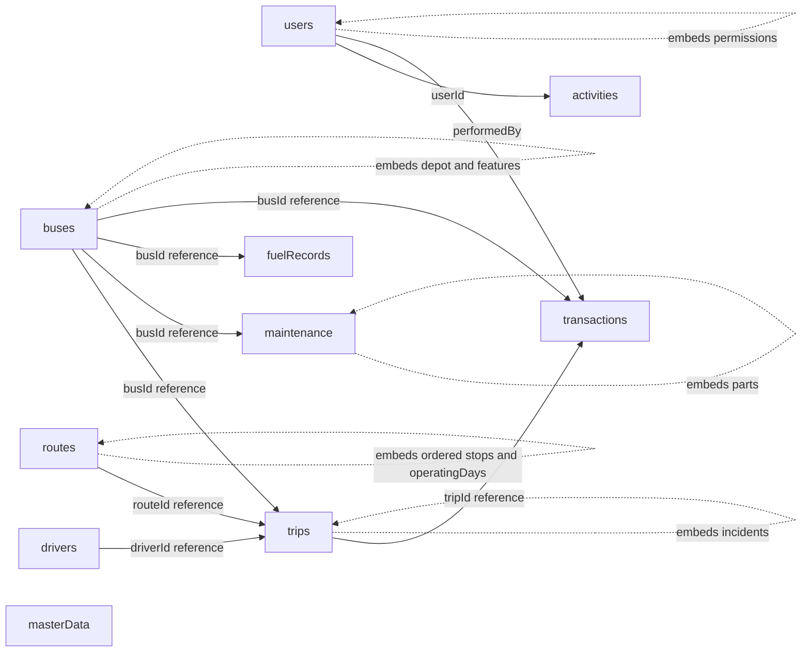

# Architecture — Bus Fleet & Route Management

## Primary goal

Build a MongoDB-first fleet and route operations system that naturally demonstrates the faculty's required NoSQL features.

## Schema and relationship diagram

The diagram separates shared operational entities (referenced by business IDs) from bounded subdocuments and arrays stored with their parent. `masterData` supplies controlled values such as statuses and categories. Aggregation reports are computed from operational collections when requested rather than persisted as duplicate report snapshots.

## Embedding

Embedded:
- `buses.depot`
- `buses.features`
- `routes.stops`
- `routes.operatingDays`
- `trips.incidents`
- `maintenance.parts`
- `users.permissions`

These are bounded, closely owned by the parent, and commonly read with the parent.

## Referencing

Referenced:
- `trips.busId`
- `trips.routeId`
- `trips.driverId`
- `maintenance.busId`
- `fuelRecords.busId`
- `transactions.busId`
- `transactions.tripId`
- `transactions.driverId`
- `transactions.performedBy`
- `activities.userId`

These entities are shared and independently updated.

## Collections and reporting

The database contains the five suggested core collections `users`, `masterData`, `transactions`, `activities`, and the operational collections needed for fleet management. Reports are generated on demand by aggregation pipelines rather than stored as duplicate snapshots in a separate `reports` collection. This avoids stale copies of analytical results; a persistent `reports` collection can be added later if the application needs saved report definitions or report snapshots.

## Mandatory transaction

Assign an available bus and driver to a scheduled trip. The operation atomically:
1. Updates bus status.
2. Updates trip status and assignment.
3. Creates a business transaction record.
4. Creates an audit activity.

Failure at any step causes an abort.

## Advanced feature

RDBMS-to-MongoDB migration:
- synthetic relational schema
- extraction
- transformation
- route-stop normalization converted into an embedded array
- references retained for shared entities
- target validation and record-count comparison

## Scalability

Replica set: `rs0` with one primary and secondaries.

Sharding design: `mongos` routing to geographically distributed shard replica sets. Candidate shard keys will be evaluated against query/write distribution rather than selected arbitrarily.
